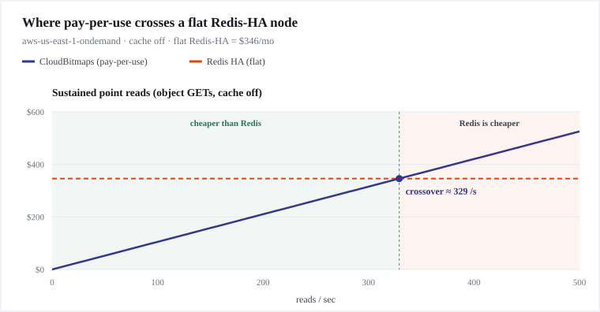

# CloudBitmaps — benchmarks & the Redis crossover

> **Generated, not hand-written.** The chart and table below are produced by `pnpm bench` from the shipped
> `estimateCost()` in `@cloudbitmaps/tools` at the default `aws-us-east-1-ondemand` rates: the line against one three-node Redis-HA cluster,
> `ONE_REDIS_HA_CLUSTER`, whatever the data size, and the table's last row against the Redis the default profile
> sizes for the reference set. `pnpm bench:check` fails CI when either drifts from the estimator's own numbers. The
> polished, shareable version lives on the [site](../site/benchmarks.html).

> **Which figures are on which codec.** The soak ([limitation 04](../site/benchmarks.html#limits)) and the hard RSS
> ceiling were measured on the TypeScript codec, the one the store uses, on 2026-10-21; the file CI's gate wrote that day
> is the ceiling's record. The in-region run and the large-operand run of 2026-10-30 were measured on the TypeScript codec,
> through the published packages (each run's evidence names the release, as `packageVersion`). The read, fleet-memory and at-scale figures were measured on the native codec, in the release each
> section names, and are to be re-measured. The cost model and the
> crossover do not depend on the codec. [The TypeScript codec against native](#the-typescript-codec-against-native)
> has the comparison, and [the public bitmap class against native, in memory](#the-public-bitmap-class-against-native-in-memory)
> is a third body of figures, taken in a loop with no store.

CloudBitmaps bills per request and per byte; a Redis-HA cluster bills a flat monthly rate. Below a certain
sustained read rate, pay-per-use is far cheaper; above it, the cluster wins. This is that crossover.

There is **one** crossover, not two, because a loaded store has no per-id write to plot: data enters as a whole
generation — one object PUT, a few when multipart, then the pointer — which the estimator prices as `loadsPerMonth`
rather than as a rate. Reads are the axis where a flat, always-on cluster competes.

## The crossover chart

<!-- BENCH:CHART:START -->

<!-- BENCH:CHART:END -->

<!-- BENCH:STATS:START -->
| Scenario | Value | Basis | Verdict |
| --- | --- | --- | --- |
| At-rest (1.2 GiB, no traffic) | **$0.03/mo** | 0.008% of the $346 cluster | win-big |
| Read crossover | **329.15 reads/s** | object GETs, cache off | past here the cluster is cheaper |
| Redis-HA baseline | **$346/mo** | one cluster, whatever the data size | the comparison line |
| The Redis the default prices for the 1.2 GiB set | **$142.35/mo** | 3 × cache.t4g.medium, the cheapest cluster in the catalogue that holds it | the line would sit at 135.42 reads/s |
<!-- BENCH:STATS:END -->

The comparison line is **$346/mo**, standing, whether or not you send it traffic: an ElastiCache HA cluster of
**1 primary + 2 replicas on `cache.m7g.large`** (~$115/mo single-node). The spec is stated because the number is
otherwise unauditable — a reader cannot judge a baseline without knowing whether it is sized for the reference
dataset or several times larger than it. Look up the instance class and check us.

"Redis" is the legible example of the axis, not the opponent: the axis is **reserved capacity vs metered
requests**, and any always-on node crosses any per-request meter somewhere.

## How these stay honest

Every number above is turned into a **deterministic, build-breaking CI assertion** in
[`tests/bench/anchors.test.ts`](../tests/bench/anchors.test.ts), and the estimator's request counts in
[`tests/tools/cost.test.ts`](../tests/tools/cost.test.ts); `pnpm bench:check` holds the chart, the table and
`bench/results.json` to the same estimator — a regression or an overclaim fails the build:

- **Counting is free** — `count()` on a loaded segment performs **0 payload reads**, and a cold one is **one pointer
  read** and no read of the object: the registry row records the generation's id count. The index sum answers only
  when the row has no summary it can use.
- **Chunk-skipping works** — the chunks a 5%-overlap intersection fetches come to ≤ 10% of the bytes of a full
  two-segment download (measured through the metrics sink, which counts chunk reads).
- **Cheap at rest** — the reference ~1.2 GiB set with no traffic costs ≤ 10% of the $346 cluster.
- **The published crossover is the modelled one** — the estimator's read crossover, at the pessimal cache
  posture, is asserted against the rate this page prints, over the same $346 baseline.
- **The estimator never quotes fewer chunk reads than the engine makes** — priced against the chunk GETs a metrics
  sink observed for a point-read workload on an in-memory store, the prediction must land on or above the measured
  cost. That covers point reads' chunk GETs.
- **The estimator counts what the engine sends** — a cold intersect's pointer and index reads for each operand before
  its chunks, what `store.load()` adds to a load's object write, the registry reads and writes of a retirement and of a purge in
  the retention sweep, and at most one pointer read per hot segment per `cache.genTtlMs`. A test drives the real engine over the single-bucket registry protocol and holds each count to
  the requests it makes, on S3's request shape, which GCS shares. Azure Blob shares it for a pointer read and makes
  two requests for a tail read, which the pricing profile's `requestsPerSizedRead` carries; `requestsPerPointerRead`
  carries a pointer read's. A fleet of readers pays the refresh once per reader,
  which `readerProcesses` carries. And it still quotes low where it cannot see: more hot segments than a reader
  keeps open (1,024 by default), which re-opens them as it reads them; the index every reader opens again after
  each load; an intersect slow enough to outlive `cache.genTtlMs`, which re-reads its pointers; an encrypted operand, or one whose row has no summary the store can use, whose
  index outgrows the tail read, one more GET; and a load that loses a publish race, which reads the pointer again.

## Real-cloud calibration — AWS

One run of the loaded store against real S3 in `us-east-1` is published here, driven from AWS CloudShell inside the
region. It measured the published packages on the topology that ships, with the pointer in the same bucket as
the data: what a cold intersect, an `andNot` and a load cost, and how long they take.

### The in-region run — run `2026-10-30-16fa6`

> **Codec:** the TypeScript codec, the one the store uses in the release the run installed (named by the evidence's `packageVersion`).
>
> **Measured** against real S3 in `us-east-1` on 2026-10-30 (UTC), from AWS CloudShell in the same region, with the
> packages then published (the evidence names the version, as `packageVersion`) and a client of 128 sockets, the number this release's own client allows: a round-trip
> floor of 8 ms (7.44 ms). The run's report explains every figure:
> [`bench/calibration/2026-10-30-16fa6.md`](../bench/calibration/2026-10-30-16fa6.md). The evidence beside it is the
> harness's own results file. [`tests/docs/calibration-reports.test.ts`](../tests/docs/calibration-reports.test.ts)
> holds this section and the report to it in both directions: every dollar amount, percentage, duration, byte size
> and ratio, every number written before the request, chunk, id or load it counts, and the bill below, row by row.

A combine or `iterate` reads each operand's needed chunks as ranges: chunks within 256 KiB of each other are one request,
up to 1 MiB, and each chunk is checked exactly as when it is read alone. So a request count follows how the shared
chunks lie in the object, not how many there are.

**What it establishes:**

- **Chunk-skipping works on real S3.** 40 of 40 cold intersects of two 500,000-id segments returned the planned ids,
  checked by count and by sum. Each fetched 100 of 1,999 chunks per segment, the 100 the two share, and skipped the
  other 95.0%.
- **A cold intersect of that shape took 107.87 ms at the median** (p95 158.44 ms, p99 159.23 ms) and made 6 GETs: one
  pointer read and one 256 KiB tail read per operand, and one range read each for the shared chunks, which lie together.
  Each GET round took about 27 to 34 ms (**derived**), more than the round-trip floor.
- **The same intersect with the 100 shared chunks spread across each segment** took 117.32 ms at the median and also made
  6 GETs. Each range returned 1,022,196 bytes of an operand, against the 51,600 bytes the packed layout's range returned:
  the bytes between the chunks come with them (**derived**).
- **Latency grows with the overlap, the requests do not.** At 1,000 shared chunks the median was 194.87 ms, and at
  2,000 it was 298.74 ms, 1.53 times as long for twice the chunks, with 6 GETs both times: each range carried more bytes.
- **A warm intersect took 7.72 ms** at the median and made no request.
- **Point reads.** A cold `count()` is one request, 27.12 ms at the median. `has()` on an open segment is one
  request, 28.43 ms, and microseconds once the chunk is cached.
- **Load throughput.** A single-part `store.load()` of a 1.05 MB segment ran at 2.25 million ids a second, 4,744,638
  bytes a second; a multipart load of a 12.6 MB segment at 6.11 million ids a second, 6,131,833 bytes a second.
  Every load was a segment's first, and made 2 PUT + 3 GET single-part and, for a multipart load, 5 PUT-class + 3 GET.
- **`andNot`** of a 1,999-chunk segment against ten excludes took 364.53 ms at the median and made 33 GETs: for each
  of the eleven operands, a pointer read, a tail read and one range read.
- **A steady `store.load()` at `keep: 12` is measured**, on the same run. One segment was loaded in 18 loads, and each
  load made the requests of its kind (the table below). A segment's first load made 2 PUT + 3 GET. A reload made
  2 PUT + 2 GET. A load that deleted by name made 2 PUT + 5 GET and a delete. Each load that collects, by name or by listing, reads the registry once more after its last delete, a GET a load that
  collects makes to see a rollback that landed during the collection
  ([the loading guide](guide/loading.md#a-rollback-that-races-a-collection)). The table has what each made.
- **Every stage made the requests of the previous in-region run, and the bill is the same.** The
  requests by class and the counts per stage did not move, so the figures above that count requests (6 GETs a cold
  intersect, 33 an `andNot`, the cost of each kind of load) are unchanged. The medians, the load rates and the rounds are
  this session's, and latencies of runs from different CloudShell sessions are not comparable, so no difference between the two is
  called a speed-up or a slowdown.
- **The rounds sit above the rounds model.** A cold intersect took 3.8 rounds against the model's 3, and the sweeps
  7.3 and 9.8. The client had 128 sockets and no stage held more than 11 requests in flight, so a socket limit did not
  bind. The run does not say why the rounds are above the model.

| Operation | Requests | One | Per million | Label |
| --- | --- | --- | --- | --- |
| Cold intersect, two 500,000-id segments sharing 100 of 1,999 chunks, the median measured | 6 GET | $0.0000024 | **$2.40** | derived |
| The same, with each pointer read once, as inside the region | 6 GET | $0.0000024 | $2.40 | expected |
| A segment's first single-part `store.load()` in the calibration run, a 1.05 MB segment, pointer included | 2 PUT + 3 GET | $0.0000112 | **$11.20** | derived |
| A segment's first multipart `store.load()` in the calibration run, a 12.6 MB segment | 5 PUT-class + 3 GET | $0.0000262 | **$26.20** | derived |

A steady load, by kind of load, at `keep: 12` on the same run: the requests are measured, and
the price is the list price.

| Kind of load | Loads | Requests | One | Per million | Median time |
| --- | --- | --- | --- | --- | --- |
| First | 1 | 2 PUT + 3 GET | $0.0000112 | **$11.20** | 154.25 ms |
| Reload | 12 | 2 PUT + 2 GET | $0.0000108 | **$10.80** | 163.86 ms |
| By name | 4 | 2 PUT + 5 GET + 1 delete | $0.0000120 | **$12.00** | 257.11 ms |
| Listing | 1 | 3 PUT-class + 6 GET + 1 delete | $0.0000174 | **$17.40** | 307.73 ms |

A cycle is 16 loads, of which 15 delete by name and one lists. Averaged over a cycle, the run's price was $12.34 per
million single-part loads (**derived**, from the two kinds it is made of; the run listed once). The first load and the listing are one load each,
so their medians are single loads. The run measured `keep: 12` only: it does not establish the requests at another
`keep`, and the delete is free.

**Derived** rows are measured request counts times the `aws-us-east-1-ondemand` list prices: the GETs and PUT-class requests are
measured, and the price is the list price. The second row is the code's prediction, which the run met exactly. The two
load rows are a segment's first load; a reload and a steady load are in the table above. PUT-class requests are the ones S3 bills at the PUT rate, listings
included. The whole run was 138 PUT-class and 5,167 GET-class requests, teardown included, and its requests cost
$0.0027568, against a projected upper bound of $0.045616. Inside the region there is no data-transfer charge to add.

**Against the $346-a-month Redis-HA line**, that is 144.2 million cold intersects of this shape a month, 54.9 every
second, or 30.9 million single-part loads at the run's price for one. Below those rates this design costs less; above them, the standing
node does. Every intersect in the run was cold on purpose. A long-lived reader answers a repeat from memory, and pays
instead for the pointer refresh: at most one GET per segment every 2 s while the segment is being read.

**What it does not establish:**

- **Lambda.** A function's cold start and initialisation need a run from inside one.
- **Other shapes**: more operands, other combine shapes, the `*Into` verbs.
- **Chunks that lie far apart.** Shared chunks with more than 256 KiB between them, or spread over more than 1 MiB, make
  more than one range request; the run's layouts, packed and spread, were one range.
- **Bytes outside the region.** Inside the region S3 Standard does not bill the bytes read. Across regions and to the
  internet it does, and the transfer can cost more than the requests saved
  ([production](guide/production.md#reading-ranges-the-bytes-between-chunks)). The spread layout's ranges read
  1,022,196 bytes a range, against the packed layout's 51,600; what that costs outside the region is not measured.
- **Other clouds.** GCS and Azure Blob have no in-region run.
- **One client on one day.** The 27 to 34 ms GET round is this run's, not a guarantee. Latencies of runs from different CloudShell sessions are not comparable; the request counts are what repeats.
- **A steady load at other `keep` values.** The run measured `keep: 12`, one first load and one load that lists.

**`estimateCost()` counts what this run's bill counted**: each cold operand's pointer and tail read, and a request for
each range read, which prices this run's intersect at 6 GETs; what `store.load()` adds to its object's write; and the
pointer refresh, for the segments a long-lived reader keeps reading. The
[guide](guide/cost.md#what-each-term-counts) says what each term counts.

### Expected, not measured

> **Expected**, not measured. The counts are what the engine makes, taken by running it over the in-memory backend on the
> calibration's layouts ([`bench/range-counts.json`](../bench/range-counts.json), written by
> [`bench/range-counts.cjs`](../bench/range-counts.cjs) and held to the engine in CI); each dollar figure is a count at the
> `aws-us-east-1-ondemand` list prices.

| Operation | Requests | One | Per million | Label |
| --- | --- | --- | --- | --- |
| `iterate` over a 1,999-chunk segment | 3 GETs: a pointer and a tail read, and one range | $0.0000012 | $1.20 | expected |

The run did not time `iterate`. Its count follows the same rule as the combines the run measured. A segment's first
and reload loads are measured by the run above, and so are its steady loads. For the sizing
guide's medium and large deployments, whose chunks are larger, the requests are [counted for each overlap and
layout](guide/sizing.md#how-much-the-overlap-matters). The layouts are the calibration's, of about 500-byte chunks;
real ids are often denser, and the guide counts larger chunks.

## Large operands — run `2026-10-30-5a2f4`

> **Codec:** the TypeScript codec, the one the store uses in the release the run installed (named by the evidence's `packageVersion`).
>
> **Measured** against real S3 in `us-east-1` on 2026-10-30 (UTC), from AWS CloudShell in the same region (2 CPUs, a
> round-trip floor of 8.9 ms to the region, so in-region), through the published packages (the evidence names their release, as `packageVersion`). This is the second run of
> the harness's [large suite](../bench/README.md#the-large-suite), the first being [`2026-10-07-88cd3`](../bench/calibration/large/2026-10-07-88cd3.json): combines on operands of about a million, five million
> and ten million ids, about 1,500 chunks each, 20 % of their ids shared. The evidence is
> [`bench/calibration/large/2026-10-30-5a2f4.json`](../bench/calibration/large/2026-10-30-5a2f4.json). It has no report
> file; this section and the evidence's own gate (`tests/bench/calibrate-large.test.ts`) are its record.

**Cold combines.** Each row is 40 uncached reads on a fresh store. Every read returned exactly the ids the layout says,
and every median GET count is the one the engine was expected to make (**measured**).

| Ids an operand | Combine | Median | 95th percentile | 99th percentile | Median GETs | As expected |
| --- | --- | --- | --- | --- | --- | --- |
| 1,000,000 | `intersect` | 113.1 ms | 321.7 ms | 413.7 ms | 6 | yes, exact |
| 1,000,000 | `union` | 169.1 ms | 236.1 ms | 259.7 ms | 8 | yes, exact |
| 1,000,000 | `andNot` | 128.3 ms | 156.1 ms | 170.9 ms | 7 | yes, exact |
| 5,000,000 | `intersect` | 141.8 ms | 188.8 ms | 402.6 ms | 8 | yes, exact |
| 5,000,000 | `union` | 513.1 ms | 678.4 ms | 751.5 ms | 24 | yes, exact |
| 5,000,000 | `andNot` | 290.3 ms | 391.3 ms | 401.8 ms | 16 | yes, exact |
| 10,000,000 | `intersect` | 164.4 ms | 266.1 ms | 326.0 ms | 10 | yes, exact |
| 10,000,000 | `union` | 651.2 ms | 839.5 ms | 844.4 ms | 26 | yes, exact |
| 10,000,000 | `andNot` | 370.4 ms | 505.2 ms | 507.6 ms | 18 | yes, exact |

**The `*Into` verbs.** Each verb ran 5 calls a size onto a destination segment of its own, on a fresh store, and each
published exactly the cardinality the layout says. An output of more than one part is written as a multipart
upload. The median is of the 5 calls; the first call makes one GET more than the repeats (**measured**).

| Ids an operand | Verb | Median | Output | Written as | PUT-class a call | GETs a call (first, repeat) |
| --- | --- | --- | --- | --- | --- | --- |
| 1,000,000 | `intersectInto` | 273.3 ms | 0.41 MB | one PUT | 2 | 9, 8 |
| 1,000,000 | `unionInto` | 389.4 ms | 3.67 MB | one PUT | 2 | 11, 10 |
| 1,000,000 | `andNotInto` | 310.0 ms | 1.63 MB | one PUT | 2 | 10, 9 |
| 5,000,000 | `intersectInto` | 294.8 ms | 2.01 MB | one PUT | 2 | 11, 10 |
| 5,000,000 | `unionInto` | 1,344.9 ms | 18.07 MB | 3 parts | 6 | 27, 26 |
| 5,000,000 | `andNotInto` | 597.6 ms | 8.03 MB | one PUT | 2 | 19, 18 |
| 10,000,000 | `intersectInto` | 348.6 ms | 2.26 MB | one PUT | 2 | 13, 12 |
| 10,000,000 | `unionInto` | 1,302.3 ms | 20.32 MB | 3 parts | 6 | 29, 28 |
| 10,000,000 | `andNotInto` | 954.3 ms | 9.03 MB | 2 parts | 5 | 21, 20 |

**Loads.** The six operands went through `store.load()`: a single-part load (the 1,000,000-id operands, 2 loads) at a
median of 2.88 million ids a second, and a multipart load (the 5,000,000 and 10,000,000-id operands, 4 loads) at 5.54
million ids a second (**measured**).

**The run's requests.** Each stage made exactly the requests it was expected to, and none more, with no discarded
sample (**measured**):

| Stage | PUT-class | GET-class |
| --- | --- | --- |
| loads | 24 | 18 |
| intersects | 0 | 960 |
| unions | 0 | 2,320 |
| `andNot`s | 0 | 1,640 |
| `*Into` calls | 145 | 714 |
| the whole run, the bucket's own requests included | 173 | 5,663 |

The evidence records the run's bill, by request class, at the `aws-us-east-1-ondemand` list prices (`cost` in the file).

**Against the first run** (**measured**): every stage made the same requests, by class, as that run's, and the
bill recorded in the evidence is the same. Only the bytes moved differ, slightly: the bytes of the whole reads (the pointers) are 38,000 more in each combine stage and 22,588 more in the `*Into` stage, each load uploads 156 to 160 bytes more, and the `*Into` stage uploads 11,313 more over its 45 calls.
The medians and percentiles are this session's, and latencies of runs from different CloudShell sessions are not
comparable, so no difference between the two runs is called a speed-up or a slowdown.

**What these figures are not.** The large suite drains each read a chunk at a time with `.batches()`; the default suite
drains one id at a time, so the latencies above are **not comparable** with the in-region run's. Latencies of runs from
different CloudShell sessions are not comparable either, and this is one session. It is one client, with 128 sockets and
2 CPUs, one storage class in one region, cold reads on fresh stores, and operands of array and bitset containers, none of
them run-encoded.

## Counting a combine — counted in memory, not measured

> **Counted**, not measured. These are the requests and bytes the engine makes, taken by running it over the in-memory
> backend ([`bench/combine-counts-results.json`](../bench/combine-counts-results.json), written by
> [`bench/combine-counts.cjs`](../bench/combine-counts.cjs) and held to the engine in CI by `pnpm
> bench:combine-counts:check`). No time was recorded and no cloud was touched; a count of requests and bytes is the same on
> every machine, and a latency is not.

**What was counted.** For each shape, the size of a combine three ways: the count method (`intersectCount`, `unionCount`
or `andNotCount`); the stream-and-count recipe, which streams the combine in batches and adds up the lengths of the
arrays; and the `*Into` workaround, which writes the combine to a scratch segment and calls `count()` on it. For each, the
requests by class (range reads, tail reads and pointer reads, and the writes the `*Into` run makes) and the bytes the
reads returned. The shapes are two operands of 500,000, 1,000,000, 5,000,000 and 10,000,000 ids over about 2,000 chunks
each, sharing 100 of them, and a union of 31 operands of 500,000 ids on the same chunks. Each runs on two layouts: **packed**,
where the shared chunks come first in each object, and **spread**, where they are spread over each object with each
operand's own chunks between them. All three ways returned the same answer on every cell.

**The stop rule, written before the first run:** the count ships only if it makes no more requests than the stream-and-count recipe on
every cell, and reads fewer bytes than the recipe on union and andNot on the packed layout, and no more bytes than the
recipe on every other cell (the spread layout, and intersect on either layout). The `*Into` run is reported, not judged.
**Verdict: every cell passed.**

**Packed layout** (counted).

| Operands (ids) | Count method | Count: requests | Count: range / tail / pointer | Count: bytes read | Recipe: requests | Recipe: bytes read | `*Into`: requests | `*Into`: bytes read | `*Into`: bytes written |
| --- | --- | --- | --- | --- | --- | --- | --- | --- | --- |
| 2 × 500,000 | `intersectCount` | 6 | 2 / 2 / 2 | 627,488 | 6 | 627,488 | 12 | 627,488 | 52,712 |
| 2 × 500,000 | `unionCount` | 6 | 2 / 2 / 2 | 627,488 | 6 | 2,587,256 | 12 | 2,587,256 | 2,050,461 |
| 2 × 500,000 | `andNotCount` | 6 | 2 / 2 / 2 | 627,488 | 6 | 1,607,372 | 12 | 1,607,372 | 998,987 |
| 2 × 1,000,000 | `intersectCount` | 6 | 2 / 2 / 2 | 727,488 | 6 | 727,488 | 12 | 727,488 | 102,712 |
| 2 × 1,000,000 | `unionCount` | 6 | 2 / 2 / 2 | 727,488 | 8 | 4,586,256 | 14 | 4,586,256 | 3,999,461 |
| 2 × 1,000,000 | `andNotCount` | 6 | 2 / 2 / 2 | 727,488 | 7 | 2,656,872 | 13 | 2,656,872 | 1,948,487 |
| 2 × 5,000,000 | `intersectCount` | 6 | 2 / 2 / 2 | 1,527,888 | 6 | 1,527,888 | 12 | 1,527,888 | 502,912 |
| 2 × 5,000,000 | `unionCount` | 6 | 2 / 2 / 2 | 1,527,888 | 24 | 20,586,252 | 30 | 20,586,252 | 19,599,257 |
| 2 × 5,000,000 | `andNotCount` | 6 | 2 / 2 / 2 | 1,527,888 | 15 | 11,057,070 | 21 | 11,057,070 | 9,548,285 |
| 2 × 10,000,000 | `intersectCount` | 6 | 2 / 2 / 2 | 2,165,888 | 6 | 2,165,888 | 12 | 2,165,888 | 821,912 |
| 2 × 10,000,000 | `unionCount` | 6 | 2 / 2 / 2 | 2,165,888 | 36 | 33,339,872 | 42 | 33,339,872 | 32,033,877 |
| 2 × 10,000,000 | `andNotCount` | 6 | 2 / 2 / 2 | 2,165,888 | 21 | 17,752,880 | 27 | 17,752,880 | 15,606,095 |
| 31 × 500,000 | `unionCount` | 93 | 31 / 31 / 31 | 9,726,064 | 93 | 40,102,468 | 99 | 40,102,468 | 31,017,807 |

**Spread layout** (counted).

| Operands (ids) | Count method | Count: requests | Count: range / tail / pointer | Count: bytes read | Recipe: requests | Recipe: bytes read | `*Into`: requests | `*Into`: bytes read | `*Into`: bytes written |
| --- | --- | --- | --- | --- | --- | --- | --- | --- | --- |
| 2 × 500,000 | `intersectCount` | 6 | 2 / 2 / 2 | 2,567,648 | 6 | 2,567,648 | 12 | 2,567,648 | 52,811 |
| 2 × 500,000 | `unionCount` | 6 | 2 / 2 / 2 | 2,567,648 | 6 | 2,587,256 | 12 | 2,587,256 | 2,050,559 |
| 2 × 500,000 | `andNotCount` | 6 | 2 / 2 / 2 | 2,567,648 | 6 | 2,577,452 | 12 | 2,577,452 | 999,085 |
| 2 × 1,000,000 | `intersectCount` | 8 | 4 / 2 / 2 | 4,509,040 | 8 | 4,509,040 | 14 | 4,509,040 | 102,811 |
| 2 × 1,000,000 | `unionCount` | 8 | 4 / 2 / 2 | 4,509,040 | 8 | 4,586,256 | 14 | 4,586,256 | 3,999,559 |
| 2 × 1,000,000 | `andNotCount` | 8 | 4 / 2 / 2 | 4,509,040 | 8 | 4,547,648 | 14 | 4,547,648 | 1,948,585 |
| 2 × 5,000,000 | `intersectCount` | 24 | 20 / 2 / 2 | 18,679,412 | 24 | 18,679,412 | 30 | 18,679,412 | 503,011 |
| 2 × 5,000,000 | `unionCount` | 24 | 20 / 2 / 2 | 18,679,412 | 24 | 20,586,252 | 30 | 20,586,252 | 19,599,355 |
| 2 × 5,000,000 | `andNotCount` | 24 | 20 / 2 / 2 | 18,679,412 | 24 | 19,632,832 | 30 | 19,632,832 | 9,548,383 |
| 2 × 10,000,000 | `intersectCount` | 34 | 30 / 2 / 2 | 28,661,312 | 34 | 28,661,312 | 40 | 28,661,312 | 822,011 |
| 2 × 10,000,000 | `unionCount` | 34 | 30 / 2 / 2 | 28,661,312 | 36 | 33,339,872 | 42 | 33,339,872 | 32,033,975 |
| 2 × 10,000,000 | `andNotCount` | 34 | 30 / 2 / 2 | 28,661,312 | 35 | 31,000,592 | 41 | 31,000,592 | 15,606,193 |
| 31 × 500,000 | `unionCount` | 93 | 31 / 31 / 31 | 39,798,544 | 93 | 40,102,468 | 99 | 40,102,468 | 31,017,806 |

Where the operands share few chunks and those chunks are together (packed), `unionCount` and `andNotCount` read only the
shared chunks, because a chunk only one operand holds is answered from its index; the recipe reads every chunk. On the
spread layout a union's count reads from under 1 % (the 500,000-id shapes) to 14 % (the 10,000,000-id shape) fewer bytes than the
recipe, since the shared chunks sit among the others, and an intersect reads the same bytes as its recipe on both. The `*Into` run reads what the recipe reads and also writes the
scratch segment, so it makes more requests.

**What this does not show.** It records no time: whether a smaller read is a faster one on S3 is not measured. It touched
no cloud, so request prices, latency and the behaviour of a real object store are not in it. It ran on the in-memory
backend, over chunks of 250 ids (the 500,000-id shapes, the calibration's own layout) to 5,003 ids (the 10,000,000-id shape)
each; real ids can be denser or sparser, and operands with other overlaps, run-encoded containers or more than the shapes
above are not counted. The count methods are not measured on S3
yet ([what is still owed](#what-is-still-owed)).

## At scale — measured (1K → 10K → 100K segments)

> **Codec:** the native codec (the results file was last committed before the switch to the TypeScript codec). Not re-run on the TypeScript codec: the retained-heap column is the reader cache's heap, which the codec does not change, but the chunk-skipping intersect row does run the codec. To be re-measured.
>
> **Measured, not modeled.** Unlike the cost curve above (which comes from the estimator), the numbers here are
> wall-clock + memory from a real run of `pnpm bench:scale` that builds a fleet of up to 100K segments on local
> disk and reads across all of it, and intersects two large segments on in-memory storage. They're
> machine-dependent — a point-in-time snapshot, **not** a CI gate. What CI does check is that the table below is
> what the committed results file renders.

Three things could make a large fleet expensive to run: an unbounded `.crbm` reader cache, an `O(total)`
fleet-wide registry scan, and an intersection of large segments that read more than it needs. This is the
measured evidence at fleet scale:

<!-- BENCH:SCALE:START -->
| Fleet | Retained heap (cap 1024) | Peak RSS | Discovery scan |
| --- | --- | --- | --- |
| 1,000 segments | 8.2 MiB | 68.1 MiB | 87.6 ms |
| 10,000 segments | 8.3 MiB | 86.8 MiB | 1,067.9 ms |
| 100,000 segments | 7.4 MiB | 162.2 MiB | 11,606.4 ms |

Intersection of two 2,000,000-id segments on in-memory storage (2,000 chunks each, 100 shared): **fetched only 100 of the 2,000 chunks per segment** — the shared keys; the rest skipped by key alignment — in 24.6 ms, which times the engine rather than object storage.

_Measured on Apple M3 Pro (arm64, node v24.18.1). **The bound is the retained heap** (post-GC), flat at 8.2 MiB @ 1,000 · 8.3 MiB @ 10,000 · 7.4 MiB @ 100,000 — the reader cache holds bounded live data regardless of fleet. Process **peak RSS** (shown for context) is a high-water that also folds in the benchmark's own fleet-*seeding* allocations and isn't returned to the OS after GC, so it grows with fleet here — it is not a clean read-path footprint (isolating read-path RSS in a reader-only process is a follow-up). Fleet seeded by writing and publishing each generation at ~38–51 durable segments/s (fsync-bound); discovery is LocalFs-filesystem-bound — the `O(total)` **shape** is the point, not the absolute ms._
<!-- BENCH:SCALE:END -->

- **Memory is a function of the working set, not the fleet.** The storage-reader cache is capped by open-segment
  _count_ (`cache.readerMax`, default 1024) **and** aggregate parsed-index _bytes_ (`cache.readerMaxBytes`,
  default 64 MiB), so **retained live heap after reading the _entire_ fleet is flat from 1K to 100K segments** — a 100×
  larger fleet holds the same resident reader set, and unusually _wide_ segments can't pin gigabytes of indices
  while the count looks "in bounds". Peak RSS is shown for context only: it is a **process high-water** that also
  folds in the benchmark's own fleet-_seeding_ allocations (not returned to the OS after GC), so it grows with
  fleet size here and is **not** a clean read-path footprint. The flat **live-heap** column is the bound. Live
  heap plus the soak's external-memory watch (typed arrays' backing stores, which the store's bitmaps use) prove **no leak** on the read path. A store with a timed refresh also keeps each segment's resolution in a second cache bounded at 8 × `cache.readerMax` entries and `cache.readerMaxBytes` / 16 bytes (8,192 and 4 MiB by default), a few hundred bytes an entry; [what each reader holds](guide/sizing.md#what-each-reader-holds) gives the heap it takes.
- **The hard RSS ceiling — measured.** A sustained read + combine + re-load workload over **400 segments**
  completes inside a hard **384 MiB** cgroup ceiling with swap disabled (`--memory-swap == --memory`), so the
  limit is a true RSS bound rather than a heap one, and it covers memory that a JS heap sample
  cannot see (the allocator's retained arenas, buffers, the runtime's own floor). The gate runs the built packages as they are: nothing it runs loads a native addon. No OOM-kill; both creep verdicts (heap and external memory) inside their bands. `pnpm rss-gate` records the
  run to `bench/rss-gate-results.json`, which the site figure gate checks the published number against.

  **Why a ceiling and not an RSS reading.** The ceiling is a property of the workload; a reader-process RSS
  figure is a property of the machine, and published as a headline it gets read as a spec the project has not
  promised. [Why a ceiling is published](#why-a-ceiling-is-published-and-not-a-number) says more.

- **The fleet-wide registry scan is `O(total segments)`** — the near-linear "discovery" column is the
  enumeration that every admin pass (`checkConsistency`, `retireExpired`, `eraseSubject`, `subjectReport`)
  pays before it does any
  work. **No read verb enumerates**: `has`, `count`, `iterate` and `intersect` each address one segment. The
  retention sweep enumerates too by default (`scan: 'fleet'`); `retireExpired({ scan: 'index' })` reads a due-day
  index instead of the fleet, and is the fast half of a pair, since a periodic `'fleet'` pass is what retires a
  policy the index missed. `checkConsistency`, `eraseSubject` and `subjectReport` always enumerate, and the
  column above is that enumeration. The total is the rows the registry holds: live segments, and retired ones still
  inside their grace. On a registry that reports `conditionalDelete` the sweep's purge removes a retired row for good,
  so a namespace that churns short-lived segments does not grow it; elsewhere each purged row stays as a tombstone the
  scan reads, and the total is every name the namespace ever held (the
  [how retention stays correct](guide/correctness.md#how-retention-stays-correct) says which backends are which).
- **Chunk-skipping intersection holds at scale** — intersecting two large multi-chunk segments fetches only the
  shared chunks and skips the rest by key alignment (the crown jewel, on the ids-per-segment axis). The
  load-bearing figure there is the chunk **count** — 100 fetched of 2,000 — because key alignment does not depend
  on how the ids inside a chunk are distributed. The accompanying **bytes** figure does: this fixture seeds each
  chunk with a contiguous run of ids, which Roaring stores as a single run, so the 3,000 bytes read (measured) over
  200 chunk reads (derived: each of the 100 shared keys is read from both segments) come to 15 bytes a read: a
  **best case for the encoding** rather than a typical segment. Real ids at that density are scattered and land in an array container nearer 2 KB per chunk. Read the byte count as "the window is
  small and bounded", not as a size to plan a bill around — for that, price the requests.

## What RSS is, and why it is the number we bound

The memory figures above are **RSS**, not heap. The difference is the whole reason the bound is meaningful, so
it is worth stating plainly.

### What RSS is

**Resident Set Size** is the amount of physical RAM a process occupies right now — not what it reserved, not
what it might use. It is the number your OS reports (`top`, Activity Monitor, `docker stats`), and it is the
number the kernel consults when a container hits its memory limit and something has to die.

### Why RSS and not the JavaScript heap

CloudBitmaps keeps a bitmap's containers in typed arrays, whose backing memory V8 allocates outside its JavaScript
object heap, and a `Buffer` read from storage is the same kind of memory. (The read, fleet-memory and at-scale figures on this page were measured on the native codec, whose containers sat in `malloc`
memory outside V8 altogether; the soak and the RSS gate were measured on the TypeScript codec on 2026-10-21.) So a process holding a large bitmap looks like this:

```
┌──────────────── RSS — what the OS sees ────────────────┐
│  Node binary, shared libraries      ~50–60 MiB, a floor │
│  V8 JavaScript heap                 ← heap sampling     │
│  bitmap containers (typed arrays)   ← INVISIBLE to it   │
│  stacks, buffers, allocator arenas  ← invisible too     │
└─────────────────────────────────────────────────────────┘
```

**A leak in the bitmap containers is invisible to a sample of the object heap.** The heap graph stays flat while the process
grows until the kernel kills it. Since ["bounded memory & cost, always"](../AGENTS.md#hard-correctness-invariants) is one of this project's
hard invariants, a measurement that cannot see the allocator doing the most work would be evidence of nothing.

RSS is the figure that includes all of it. That is why the ceiling is expressed in RSS, and why
`--memory-swap` is pinned equal to `--memory`: with swap enabled a process that outgrows RAM merely spills to
disk and keeps running, and the limit stops being a memory bound at all. With swap off it is a hard wall.

### Why a ceiling is published, and not a number

The gate answers a **pass/fail** question — *did this workload survive inside 384 MiB, or was it OOM-killed?* —
rather than reporting a measurement. Two reasons the reading is the less useful half:

1. **It is mostly Node.** The harness labels its own figure `~Node floor`: an idle Node process already sits
   around 50–60 MiB, so the workload's contribution is small against that baseline. Quoting the total would
   mostly be quoting the runtime.
2. **It moves with the machine** — allocator behaviour, page size, what the OS has handed back. Published as a
   headline it would be read as a specification this project has not promised.

The ceiling, by contrast, is a property of *the workload and the bound*, which is what the gate actually
establishes and what a reader can act on. The committed run, `bench/rss-gate-results.json`, is the file the gate wrote in CI on 2026-10-21, on the TypeScript codec: Node 22 on an x64 Linux runner under Docker. Its isolated reader process sat at 68.2 MiB of RSS, well inside the ceiling. CI runs the same gate on every push and fails the build if the workload is OOM-killed or creeps; it keeps no reading beyond that file. A latency
number moves with the machine and the network as well, which is why the latency figures above come from a run
inside the region and not from a laptop.

## What a sorted load holds in memory

> **Measured** by `tests/core/load-sorted-heap.test.ts`, which every pull request runs at the reduced size and a
> nightly run at the full size, on GitHub's Ubuntu runners with the newest Node 22 and Node 24 that `setup-node`
> installs, and which was run by hand on an Apple M3 Pro with Node 24.18.1, on 2026-10-17. The figures are heap
> readings, not RSS.

**How it is measured.** A warm-up load runs first, as a precaution. Then three `sorted: true` loads of ten and a
hundred times as many ids, spread over the same 8,192 chunks (array containers, ids three apart), so the writer's index
is the same size at every tier, and an unsorted load of the largest tier's ids: a million on a pull request, ten
million at full size. The ids come from a generator, and the storage hashes what it is sent and keeps none of it, so
neither the input nor a backend's buffer is in the figure. Every 65,536 ids and at every sink write of 32 KiB or more,
the test lets a turn of the event loop pass, forces four synchronous major collections, and reads the JS heap and external
memory (a typed array's backing store, where the codec's bitmaps live). Each figure is the highest reading over the one
taken just before the load. Every run prints its readings in its log.

**The bound, enforced on every CI run.** A sorted load's peak stays **under 3 MiB** at every tier, and the largest
tier's within 0.5 MiB of the smallest's. An unsorted load of the largest tier's ids peaks at least four times as high
as the sorted one, at most two chunk bitmaps are alive at any reading of a sorted load, and the two write the same
object. A run that breaks one fails, naming every reading.

**What it typically reads: about 1.1 MiB** for a sorted load at 8,192 chunks, at every tier from 10,000 to 10,000,000
ids, on both CI Node versions and on the M3 Pro; the unsorted load grows with its ids. The cap is more than twice that,
and the slack more than twice the largest difference read between tiers. The contrast has about twice the room it needs:
the unsorted load of a million ids has read about eight times the sorted one's peak. The smallest tier reads a little
higher than the larger two on every run, with the warm-up or without it, and why is not known; it makes the flat line's
difference smaller, never larger. What the test can detect, measured by keeping part of what a load writes: a leak of
more than about 20% of the serialized data on a pull request, and about 5% at full size.

**What these leave out.** They are samples after collection, not a high-water mark: what lives between two readings
and is gone by the next is not in them. The index's encoding writes into one buffer sized to the index, so it builds no
temporary array beside it. Measured by hand once, the same way, over all 65,536 chunks (4,000,000 ids, before the
warm-up was added): 6.76 MiB for a sorted load, against 37.78 MiB for the unsorted load. That reading is taken as the
encoded index reaches the sink, so it holds the writer's entries and the encoded index. For that load's shape (an
inference from "the same way": the heap test's generator, 61 to 62 ids and a payload of 138 to 140 bytes in each
chunk) the index is 589,824 bytes, 9 bytes a chunk, 0.56 MiB, so the entries are about 6.2 MiB. At the footer a sorted
load therefore holds about 110 bytes a chunk, **up to about 7 MiB at the 65,536 chunks a segment can have** (6.76 MiB
measured; 6.9 MiB at the densest index roaring payloads give, 11 bytes a chunk).

An encrypted segment holds more. The cipher seals the index with `cipher.update` and then `Buffer.concat` of its
output (`packages/core/src/drivers/crypto.ts`), so while it runs the plain index, `update`'s output and the
concatenated copy are all live: three index-sized buffers, two more than a cleartext segment holds. That is
6.2 + 3 x 0.56 = 7.9 MiB for the measured shape and 6.2 + 3 x 0.69 = 8.3 MiB for the densest, so **about 8 MiB**, about
125 bytes a chunk (derived from the writer's code and the measured figures). The index grows with the chunk count,
never with the ids.

Before the encoding wrote into a buffer it built a temporary array first, one number for each byte of the index (9 to
11.5 a chunk), and that array was live beside the entries while the index was encoded. The probe
`bench/index-encoder.cjs` replays the old and the new encoding over entries held live, each in a fresh process, with a
forced major collection before each reading, over the heap and the array buffers together. Run
`node bench/index-encoder.cjs` (or `--shape wide`) to reproduce the figures. Its `load` shape is the heap test's
generator described above; its `wide` shape is synthetic, with payloads of 64 to 60,063 bytes (more than a roaring chunk
makes) and cardinalities of 1 to 65,536, so its index is 11.5 bytes a chunk. Every entry is read once before the
baseline. Figures are MiB over the entries; the three columns are the array at the end of the encoding, the array and
the copy `Uint8Array.from` makes together (the peak), and the index buffer the new encoding writes (measured, M3 Pro,
Node 24):

| Shape | Chunks | Index | Before: array | Before: array and copy | After: index buffer |
| ----- | -----: | ----: | ------------: | ---------------------: | ------------------: |
| load | 8,192 | 0.07 MiB | 0.60 MiB | 0.67 MiB | 0.07 MiB |
| load | 65,536 | 0.56 MiB | 4.54 MiB | 5.11 MiB | 0.56 MiB |
| wide | 8,192 | 0.09 MiB | 0.92 MiB | 1.01 MiB | 0.09 MiB |
| wide | 65,536 | 0.72 MiB | 6.97 MiB | 7.68 MiB | 0.72 MiB |

The array is eight to ten times the index (8.1 for `load`, 9.7 for `wide`). At 65,536 chunks the encoding no longer
holds about 4 or 6.3 MiB of it at the end (3.98 MiB for `load`, 6.25 MiB for `wide`), and no longer holds about 4.5 or
7 MiB at the peak (4.55 and 6.96 MiB). A
backend's upload buffer comes on top of all of it:
[memory, and where a load runs](guide/loading.md#memory-and-where-a-load-runs).

## The TypeScript codec against native

> **Measured**, on one machine, on 2026-10-22, by `node --expose-gc bench/ts-codec-engine.cjs --all` (about an hour),
> through the store (`CloudRoaring` over `MemoryStorage`, warm cache). The machine was an Apple M3 Pro with 11 cores
> running macOS and Node v24.22.1, with the bench's load gate off, so every figure in the record carries the load beside
> it (the reads' peaks run from 1.96 to 2.62 per process in the figures below). The record is
> [`bench/ts-codec-comparison-results.json`](../bench/ts-codec-comparison-results.json): every round of every figure,
> from the clean tree at commit `c387921b`, with 22 read figures re-taken at commit `6467779c` because their controls or
> their load were out of band (each first take is kept beside the figure that replaced it).
> [`tests/bench/ts-codec-verdict.test.ts`](../tests/bench/ts-codec-verdict.test.ts) recomputes every verdict from the
> rounds. The report is [`bench/ts-codec-comparison.md`](../bench/ts-codec-comparison.md). These are wall-clock figures
> from one machine, recorded and not asserted; they are the figures taken for the switch to the TypeScript codec, and CI does not re-measure them.

**How.** Each cell times the same call on three subjects, in an order that rotates through the six permutations: the native
codec, the TypeScript codec, and the native codec again as an A/A control. A cell's figure is the median over 31 rounds of
`typescript / native - 1`, and a negative number means the TypeScript codec was faster. The bar was "no more than 5% slower
with the control within +-2%". Reads are measured in two ways, and the table gives the first: **one codec per process**
(three fresh processes, each timing every operation once per round, which is how a store runs in production, and what the
verdict uses), and in one process (three stores in one process; its figures agree on every cell that resolves and are in the
report). The write path is measured in one process only. Data sets: `dense` is 32 chunks of 32,768 ids, `sparse` 256 chunks
of 1,000, `runs` 128 chunks of 150 runs, `mixed` 128 chunks of the three kinds in turn, `spread8k` 8,192 chunks of 16 ids (a
`spread` set of the same shape over 62,500 chunks is timed on `has`, `count` and `iterate` only, since its combines take
seconds, and is in the report: `has` -1.7%, `count` -1.5%, `iterate` -11.7%).

**Reads through the store, one codec per process** (the TypeScript codec against native; negative is faster):

| operation | dense | sparse | runs | mixed | spread8k |
|---|---|---|---|---|---|
| `has` (512 probes a call) | +1.1% | -2.5% | -1.3% | -2.2% | -8.2% |
| `count` (read from the index) | -0.1% | +1.1% | +0.4% | +0.6% | +1.7% |
| `iterate` (a full stream) | -0.0% | -2.5% | -3.4% | -0.9% | -9.3% |
| `intersect`, two operands | +0.2% | -40.2% | -0.6% | -5.4% | -17.2% |
| `intersect`, four operands | +3.4% | -37.0% | +0.6% | +2.9% | -9.5% |
| `andNot` | -0.6% | -0.8% | -0.6% | -2.9% | -12.9% |

Every cell is inside the 5% bar. The worst is dense `intersect` with four operands, +3.4% (17.9 ms native, 18.6 ms
TypeScript). `count` makes no codec call, so its row measures the noise of the comparison (about +-2%), not the codec; `has`
is dominated by the store's own asynchronous call (about 1 microsecond a probe), so it has little power to show a codec
difference. The TypeScript codec's `intersect` takes operands smallest-first; the native path keeps the order it is given.
Given the same smallest-first order, native is itself 7.7% slower per process on the mixed four-operand cell than native as
shipped, and the TypeScript codec reads -3.8% against that reordered native (both measured), so the +2.9% in the table is
not purely a codec difference.

**There is no union row, and the reason matters.** Every per-operation figure on this page (here and in the paragraph after the memory table) was taken at commit `7bf70e54`, before later kernel changes (clone sharing, intersect of three or more operands smallest-first, the similar-sized array difference, the bitset-in-runs result); those figures describe the code at that commit, not the code the store comparison ran, and are to be re-measured. The store comparison is on the final kernels and is the headline. The store comparison times `intersect` and `andNot`, not `union`: no
union cell was measured through the store. The per-operation microbenchmark (one operation on one chunk, medians of 11
interleaved rounds after a warm-up, Apple M3 Pro, Node v24.18.1, commit `7bf70e54` of 2026-10-21, a load of about 2.5, record
[`bench/ts-codec-results.json`](../bench/ts-codec-results.json)) is the only union figure, and it is not a win for the
TypeScript codec: `or` on one pair of containers took 1,056 ns native and 3,124 ns TypeScript on dense/dense (2.96 times),
1,691 and 3,759 on sparse/sparse (2.22), 1,575 and 3,782 on run/run (2.40), and 3,341 against 14,099 on a skewed pair of
64 and 4,000 values (4.22), the worst pair measured. Its `and` and `andNot` on one pair are 1.3 to 3.6 times slower in the
same record, except `andNot` on the skewed pair (0.52). Through the store, the combines above are inside the bar or faster
anyway, because a store combine is dominated by chunk handling and the store's own work, not the pair kernel; that is a
measured result for `intersect` and `andNot`, and an expectation, not a measurement, for `union`.

**The write path** (in one process, 1,000,000 ids over 62,500 chunks, a fresh store per round, a garbage collection before
each timed call, 31 rounds, load 1.3 to 1.4):

| operation | native | TypeScript | change | A/A control |
|---|---|---|---|---|
| `store.load()` | 183.1 ms | 117.2 ms | -35.6% | -0.4% |
| an erasure's rewrite of one id | 195.6 ms | 129.9 ms | -33.8% | +0.3% |
| an export | 406.8 ms | 350.5 ms | -14.1% | +0.1% |

The exported bytes were identical in all 31 rounds. That is a warm process.

**A cold process is slower.** The cold row (a fresh process, a mixed set of 128 chunks, a first load of two segments, then
the first `has` calls; the median of 31 processes per codec, load 1.7) is where the TypeScript codec loses:

| first use in a fresh process | native | TypeScript | change | A/A control |
|---|---|---|---|---|
| the first `load` of two segments | 135.02 ms | 153.0 ms | +13.1% | +0.3% |
| the first `has` | 3,076.6 us | 3,262.3 us | +6.6% | +0.4% |
| the first ten `has` calls | 3.747 ms | 4.033 ms | +8.3% | +0.3% |
| the first thousand `has` calls | 8.32 ms | 8.90 ms | +7.0% | +0.1% |
| the next thousand `has` calls | 1.59 ms | 1.61 ms | +1.3% | +0.0% |
| the first full `iterate` | 465.91 ms | 483.88 ms | +1.5% | +1.5% |
| the first `intersect` | 136.43 ms | 132.91 ms | -2.8% | -0.1% |

A bulk load that is 35.6% faster warm is 13.1% slower the first time a process runs it, and the first few thousand `has`
calls are 7% to 8% slower; the record does not say why, and the first decode of each chunk is the likely cause (an expectation, not measured). The TypeScript row's process still loaded the native
addon (the bundle it ran then carried both), so it is not a measurement of a process without the addon.

**Start-up.** Loading the codec's module in a fresh process took 19.5 ms for the native addon and its codec and 1.1 ms for
the TypeScript codec (-94.2%, control +0.4%; median of 31 processes).

**Memory** (bytes per cached chunk, heap plus external as V8 counts them, median of seven repeats with each codec in a fresh
process; the native codec keeps part of its memory outside V8's counters, and how much is not measured):

| data set | native | TypeScript | TypeScript minus native (derived) |
|---|---|---|---|
| dense (64 chunks) | 4,207 | 13,082 | 8,875 |
| sparse (256) | 1,443 | 3,911 | 2,468 |
| runs (256) | 1,473 | 2,503 | 1,030 |
| mixed (192) | 1,823 | 5,915 | 4,092 |
| spread8k (8,192) | -52 | 363 | 415 |

Derived: a cache of N chunks holds about N times the figure for its kind (spread8k's native figure is below the counters' resolution, a negative count, so no ratio is meaningful there), and the chunk cache is bounded by a count of chunks. Resident
growth, which includes what V8's counters cannot see, is unreliable (an order of magnitude): its TypeScript-to-native ratio
was 1.08 on dense, 0.86 on sparse, 1.18 on runs, 1.26 on mixed and 0.95 on spread8k, with the two codecs' ranges overlapping
on all but spread8k, where every TypeScript sample is below every native one. No multiple of native's memory is claimed.

**One container pair at a time is slower, and a few operations a lot.** In the per-operation record (commit `7bf70e54`, before later kernel changes, to be re-measured; one chunk, ratio of
TypeScript to native): `optimize` on a run chunk 3.31 times (1,992 ns to 6,599 ns), `build` on a run chunk 1.75 times,
`iterate` of a dense chunk 1.35 times; the other way, `build` of a dense chunk is 0.38 times, `serialize` 0.60 to 0.75 times,
and a dense `has` 0.32 times.

**What was not measured.** The two codecs have not been compared in region against real S3 (the in-region comparison is
prepared in [`bench/README.md`](../bench/README.md#the-codec-comparison-in-region) and not run). The in-region run of 2026-10-30 ran the TypeScript codec alone, and latencies of runs from different CloudShell sessions are not comparable, so how far the codec moves a latency in region is not measured. The request counts the engine makes were measured to be
identical on both codecs (`bench/range-counts.json`, held to the engine in CI). Alpine and arm64 Lambda were not run. Only Node 22 and 24 run in CI;
Bun and Deno ran a local self-check only, so no edge-runtime claim is made. A week of nightly fuzz on the TypeScript codec had
not run when these figures were taken. The in-memory table of the public class also times a load of a bitmap, `store.load(ref, { bitmap })`, on memory storage
(see the next section); the guide's `bench:load-input` bench, which pairs a load from ids with one from a bitmap on five
sets up to 14.4M members, has no figure yet.

[Our own Roaring](guide/roaring-codec.md) says what the codec guarantees and what it can be used for alone.

## The public bitmap class against native, in memory

A third body of figures (the class is in 0.25.0 and later), apart from the store comparison above and the native-codec figures elsewhere on this page: the
public `RoaringBitmap` class, timed in a loop in memory against the pinned `roaring` package (CRoaring through its
binding) and against the codec call the store runs, one cell per operation and data set, losses printed. It has no
store and no network, so nothing hides a slow combine. The table is generated from
[`bench/bitmap-api-results.json`](../bench/bitmap-api-results.json) and printed in
[Our own Roaring](guide/roaring-codec.md#the-public-class-against-native-in-memory) and in
[the API reference](guide/api-reference.md#build-and-combine-bitmaps-by-themselves--roaringbitmap), where its header says
which commit it was taken at, on which machine; read a figure as that build on that machine, and not as a bound.
Two methods are more than 10 times native and ship with their figures shown: the union of 64 dense bitmaps with `orMany` (about 11 times) and the first `deserialize` in a fresh process (about 14.6 times; later calls 2.2 to 5.9, both ends marked as read outside the control band).
`pnpm bench:bitmap-api:check` and `pnpm bench:bitmap-api:table:check` hold the pages to the record.

## Caveats

- **Default rates, one cluster** (`aws-us-east-1-ondemand` against `ONE_REDIS_HA_CLUSTER`, cache off). Your
  region, cloud, committed term and cache-hit rate all move the crossover, and so does your data's size: the
  estimator's default prices the Redis that would hold it, which [what it costs at your size](guide/sizing.md)
  works through. Feed your own `PricingProfile` and workload to `estimateCost()` from `@cloudbitmaps/tools`.
- **Model, not a cloud bill** — the dollars in the crossover chart come from the cost formulas + published
  rates. Measured AWS dollars live in [Real-cloud calibration](#real-cloud-calibration--aws).
- **Three kinds of number here, and one heap reading.** The crossover chart is _modeled money_ (estimator, deterministic, CI-gated);
  the at-scale table is _measured memory + wall-clock_ (a real run, the fleet on local disk and the large
  intersect in memory, machine-dependent, never CI-gated — shared runners are too noisy); the sorted load's figure is
  _measured heap_ from a unit test, whose bounds CI holds; and the real-cloud section is _measured AWS cost_ (owner-run against
  a real account, on 2026-10-30, from inside the region). Only the last is cloud-calibrated, and even then the dollars are
  published prices applied to wire-metered requests, not the invoice itself.
- **Rates are the vendor's to change, and are region-specific.** Every dollar figure in this document uses the
  default `aws-us-east-1-ondemand` rates, dated where it was measured; the crossover is drawn against
  `ONE_REDIS_HA_CLUSTER`, and the stats table's last row against the Redis the default profile sizes for the
  reference set. Treat the _ratios_ as the durable
  finding and re-derive any absolute figure from your own region and contract — `estimateCost()` takes a
  `PricingProfile` so you can plug your real rates in rather than trusting ours.

## What is still owed

The [in-region run](#the-in-region-run--run-2026-10-30-16fa6) measured the loaded store's latency and load
throughput on S3. These are not published yet:

- **`iterate` on S3.** Its request count is [expected, not measured](#expected-not-measured), and the run did not time it.
- **Ranges of other sizes.** The cold intersect's and the `andNot`'s times are measured for ranges of up to about
  1 MiB; the latency of the larger chunks of a medium or large deployment, and the cost of the bytes a range reads
  outside the region, are not.
- **A Lambda figure** — a function's cold start and initialisation against a real store, from inside one.
- **The count methods on S3.** `intersectCount`, `unionCount` and `andNotCount` are [counted in memory](#counting-a-combine--counted-in-memory-not-measured), not measured on S3, and the calibration harness has no count stage.
- **`materializeMany` on S3.** Its request counts are counted in memory, not measured. The `*Into` verbs and combines on
  operands of about a million, five million and ten million ids are [measured](#large-operands--run-2026-10-30-5a2f4), with
  operands of 1,374 to 1,497 chunks, 20 % shared; operands that are run-encoded, or with other overlaps, are not.
- **Other combine shapes** — more than two operands, and other overlaps than the sweep's, against a real object store.
- **A steady `store.load()` at another `keep`.** The run above measured `keep: 12`; the requests at a `keep` of 1, or of 64, are counted by the engine and not measured on S3.
- **GCS and Azure Blob in-region runs** — the run measured S3 only.

**The harness is built, and has run for real from inside the region.** [`bench/calibrate-aws.cjs`](../bench/calibrate-aws.cjs)
(`pnpm calibrate:aws`) measures, in one run against a real bucket, in the default suite's eight stages: load throughput through
`store.load()`, single-part and multipart, each load's own requests recorded; cold `A ∩ B` latency for two 500,000-id
operands spanning ~2,000 chunks with 100 shared — the chunk-skipping ratio the at-scale section reports, at a quarter
of its density — and again with the same overlap spread uniformly over each segment's chunks; a sweep over how many
chunks the operands share; the same intersects answered again from memory, held to no requests at all; `count()` and
`has()` as a first read, `has()` on a segment already open, and both again warm; `andNot` of one segment against ten; and a steady `store.load()`, one segment loaded repeatedly at `keep: 12`, each load held to the requests of its kind. Every request the single-bucket topology
bills, pointer reads and conditional PUTs included, is counted attempt by attempt and by stage. Each intersect must
return exactly the planned ids or no latency is reported, and each cold one turns off its store's timed pointer
refresh, so its request count does not move with the network. A sample that meets a transient fault is not retried
inside its timing: it is discarded whole and run again from the start, from a state the failed attempt left nothing
cached in (a fresh store, or for a point read that assumes a store in a given state, that store put back in it), for
at most three samples a run and two a stage. Its requests are billed, projected and recorded beside its stage; every
latency and request-count figure comes from the samples each stage kept, held to their expected counts exactly,
while the bill counts both; and a run's report states how many it discarded. A fault in a load, or one past the bound,
fails the run. Every run records its own round-trip floor to the
region and labels its latency in-region only below 30 ms — a line that keeps another continent out, not a
neighbouring region, so the raw floor is recorded with it for a reader who wants a stricter one, and so is the region the shell ran in. A page states a run's latency as in-region only when that region is the bucket's too. Each cold intersect also records how many requests were in flight at once and how many it waited for one after another, and every run records the AWS SDK and handler versions and the handler's socket cap. Its run
`2026-10-30-16fa6`, from AWS CloudShell in `us-east-1`, paid the in-region rows: intersect and point-read latency,
load throughput, `andNot` with a large `exclude`, the sweep, and what `store.load()` costs on S3. The `*Into` verbs are measured by the
[large suite's run](#large-operands--run-2026-10-30-5a2f4), and the Lambda figure is not measured yet.
How it guards against spending more than it says, and how to run it from inside the region:
[`bench/README.md`](../bench/README.md#real-cloud-calibration).

Nothing above should be read as covering any of these.

<!-- No count in that sentence, deliberately: a tally in prose beside a list it does not derive from is a
     drift surface with nothing checking it, and a count that happens to be right reads as maintained. -->

## Reproduce

```sh
pnpm calibrate:aws            # projection only — touches nothing, needs no credentials
pnpm calibrate:aws --rehearse # the workload against MinIO from docker-compose, free — no money guards run
node bench/calibrate-aws.cjs --suite large   # the large suite's projection; add --rehearse to run it on MinIO
bash bench/calibrate-cloudshell.sh   # from AWS CloudShell: in-region, against the PUBLISHED packages
pnpm bench         # builds, then regenerates bench/crossover.svg, bench/results.json, and the cost table here + the site
pnpm bench:scale   # HEAVY: builds a fleet up to 100K segments on local disk (fsync-bound), measures, and prints
SCALE_INJECT=1 pnpm bench:scale   # the same, then rewrites bench/scale-results.json and the at-scale table here + the site
SCALE_FLEETS=1000,10000 pnpm bench:scale   # smaller + faster for a quick check
pnpm soak          # sustained loaded-store reads + combines + re-loads; heap/external creep verdict
pnpm rss-gate      # the same soak under a hard cgroup --memory ceiling (needs Docker)
```

The formulas are in `packages/tools/src/cost.ts` — every rate, the crossover derivation and what each term
does and does not model are stated there — and the
[cost guide](guide/cost.md) covers the estimator API.
